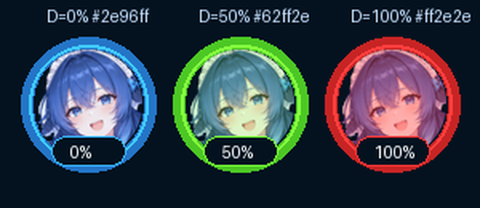

# FaceGuard 酱 · 鲸鱼娘 🐋

> **凑近屏幕的时候，会有鲸鱼娘跳出来提醒你坐回去。**

一款**全程离线**的二次元护眼距离提醒工具：摄像头 → 本地人脸检测 → 发现你持续贴脸就弹窗、上字幕、响提示音，最小化后还有一只随距离变色的鲸鱼娘悬浮球陪着你。


---

## ✨ 它有什么

- **🛡️ 贴脸报警** —— 不测绝对厘米数，而是学习你的正常坐姿作基线，人脸比基线持续放大才触发；
  EMA 平滑 + 自适应基线 + 连续多帧确认 + 冷却期，挥手、打喷嚏、路过的猫都不会误报。
- **🐋 三重提醒，各自可关** —— 鲸鱼娘弹窗（9 秒自动关）＋ 屏幕右上角悬浮字幕 ＋ 两声提示音。
- **🔵 悬浮球** —— 最小化后右下角待命，光环颜色实时反映距离：🔵 蓝 = 安全 → 🟢 黄 = 靠近了 → 🔴 红 = 贴脸报警！
  可拖动、悬停看数值、双击回主窗口、右键菜单。
- **🔒 隐私零妥协** —— 无网络请求、无遥测、无云端 API；画面只在内存里处理，不保存、不上传、不落盘，
  进程关闭即释放。模型随 EXE 内置，断网也能跑。



## 📥 下载直接用（免装 Python）

到 **[Releases 页面](https://github.com/redjoker2025/face-guard/releases/latest)** 下载单文件 `FaceGuard.exe`：

| 文件 | 说明 |
|---|---|
| [FaceGuard.exe](https://github.com/redjoker2025/face-guard/releases/latest/download/FaceGuard.exe) | 单文件、免安装、全程离线，约 68 MiB |

校验下载是否完整（PowerShell）：

```powershell
Get-FileHash .\FaceGuard.exe -Algorithm SHA256
```

当前版本的 SHA256 见 [Release 说明](https://github.com/redjoker2025/face-guard/releases/latest)。

> [!NOTE]
> - Windows 10 / 11（64 位）直接双击运行，无需安装 Python；
> - 首次启动要解压运行时，慢几秒属正常；
> - 未签名的 PyInstaller 单文件 EXE 被 SmartScreen / 杀软误报是常态，点「仍要运行」或加白名单即可。

## 🚀 从源码运行

```bat
:: 1. Windows 10/11，Python 3.9~3.14（64 位）
pip install -r requirements.txt

:: 2. 跑起来
python face_guard.py
```

点 **▶ 启动摄像头**，程序先用约 2 秒学习你的坐姿作基线，之后凑近就会提醒。

| 依赖 | 用途 |
|---|---|
| `opencv-python-headless` | 摄像头读取 + Haar 人脸检测（无 GUI 版，避开 Qt 插件冲突） |
| `pillow` | 摄像头帧刷进 Tkinter 画布；立绘缩放、圆形蒙版、颜色薄雾 |

Tkinter 是标准库；`numpy` 随 opencv 自动装上。无 GPU 要求，CPU 单线程即可实时。

## 🔧 打包成单文件 EXE

**一键脚本（推荐）**：双击 `build.bat` —— 装依赖 → 检查立绘 → 定位人脸模型 → PyInstaller 打包，产物在 `dist\FaceGuard.exe`。

或者用仓库里配好的 spec（模型路径动态定位，无需手改）：

```bat
python -m PyInstaller --noconfirm --clean FaceGuard.spec
```

踩坑要点（完整 12 条见旧版 Wiki，这里挑最容易翻车的）：

1. **人脸模型必须 `--add-data` 进 EXE**，程序已写好 `sys._MEIPASS` 查找逻辑，你只要别漏；
2. **`--add-data` 分隔符在 Windows 是 `;`**（Linux/macOS 才是 `:`）；
3. **`--windowed` 隐藏黑窗后**，崩溃信息会写到 EXE 同目录的 `face_guard_error.log`，「双击没反应」先看它；
4. **EXE 位数 = 打包用 Python 的位数**，64 位 Python 只出 64 位 EXE；
5. **分发前在一台没装 Python 的电脑上双击验证**一遍。

## ⚙️ 参数怎么调

| 控件 | 含义 | 调参建议 |
|---|---|---|
| 靠近触发阈值 | 人脸相对基线放大多少倍触发（1.05~1.60，默认 1.25） | 误报多 → 调大；太迟才报 → 调小 |
| 触发灵敏度 | 报警前需连续确认的帧数（1~10，默认 5 → 连续 7 帧） | 晃动误报 → 调低；想秒报 → 调高 |
| 报警冷却秒数 | 两次报警最小间隔（5~120 秒，默认 30） | 按需即可 |
| 弹窗 / 悬浮字幕 / 提示音 | 三种提醒方式的开关 | — |
| 最小化时显示悬浮球 | 悬浮球总开关 | 嫌挡视线就关掉 |
| 设备编号 | 摄像头索引（默认 0 = 自带摄像头） | 外接摄像头打不开时试 1、2 |

## 🧩 边界情况

| 场景 | 程序行为 |
|---|---|
| 摄像头打不开 / 被占用 / 无权限 | 弹窗说明原因与排查步骤，界面复位可重试 |
| 画面里没有人脸 | 不触发，连续帧计数清零，悬浮球回到蓝色 0% |
| 单帧晃动 / 突变 | EMA 平滑 + 连续多帧确认 + 太远不参与判定，三重过滤 |
| 长时间贴脸不动 | 基线冻结 + 冷却期内不重复报警，冷却结束仍贴近才再提醒 |
| 最小化主窗口 | 检测线程继续跑，提醒照常，悬浮球实时变色 |
| 运行中摄像头被拔出 | 约 1 秒后自动停止并弹窗 |
| 立绘素材缺失或损坏 | 自动退回 Canvas 矢量鲸鱼娘，界面不会开天窗 |

## 🔒 隐私说明

- 代码里**没有任何网络请求**，不下载、不上传、不含遥测；
- 人脸检测模型（OpenCV 官方 Haar 级联，<1MB）随 EXE 内置；
- 摄像头帧只在内存完成「缩放 → 灰度 → 检测 → 画框」，进程关闭即释放，不落盘；
- 立绘是随 EXE 内置的 PNG，不需要联网获取。

## ❓ 常见问题

- **双击 EXE 没反应**：看同目录 `face_guard_error.log`，九成是杀软拦截或模型没打进去。
- **画面黑屏**：检查 Windows 隐私设置是否允许桌面应用访问相机；或摄像头被别的程序占用。
- **报得太勤 / 太懒**：按「参数怎么调」改阈值与灵敏度，状态栏的「距离水平 vs 触发线」能直观看到差距。
- **最小化后没看到悬浮球**：确认勾选了「最小化时显示悬浮球」；多显示器时可能出现在主显示器边缘。
- **悬浮球颜色一直是蓝的**：说明检测线程没在跑（没点启动，或摄像头报错停了）。

## 🗂️ 目录结构

| 路径 | 说明 |
|---|---|
| `face_guard.py` | 全部源码（单文件，含详细注释） |
| `assets/` | 鲸鱼娘透明 PNG（半身立绘 + 头部特写） |
| `artwork/` | 立绘原图（抠图脚本的输入） |
| `tools/make_mascot.py` | 抠图脚本（洪水填充去背景 + 去白边，可复现） |
| `build.bat` | 一键打包脚本 |
| `FaceGuard.spec` | PyInstaller 配置（模型路径动态定位） |
| `docs/` | README 渲染图 |

## 📜 版本历史

| 版本 | 主要变化 |
|---|---|
| **v2.2** | 新仓库首发；打包配置不再硬编码本机路径（spec 动态定位模型）；许可证定为 MIT；README 全面重写 |
| v2.1 | 鲸鱼娘换成真立绘（抠图透明 PNG）；悬浮球改为「圆形头像 + 距离色光环」 |
| v2.0 | 深海蓝渐变主题；新增最小化悬浮球（蓝→红表示远近） |
| v1.0 | 首个版本：摄像头 + Haar 人脸检测 + 靠近判定 + 三重提醒 |

## 📄 许可证

[MIT License](LICENSE)
